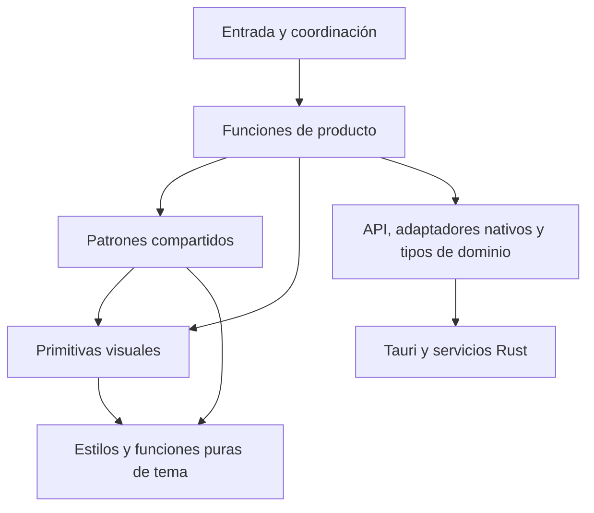

# Arquitectura de componentes de Neubiki

Windows y Android comparten la misma aplicación React y el mismo catálogo. Las vistas se componen a partir de primitivas visuales, patrones y funciones con un responsable definido. Los flujos dependen de contratos del runtime para acceder a Proton, conservar borradores y ejecutar operaciones. [Sistema de diseño](../product/design-system/README.md).

## Capas y límites

| Capa | Ubicación bajo `apps/desktop/src` | Responsabilidad |
| --- | --- | --- |
| Entrada y coordinación | `main.tsx`, `app/` | Arranque, contexto global y composición. Inyecta capacidades del runtime cuando corresponda. |
| Funciones de producto | `features/<función>/` | Vistas, composiciones y adaptadores que conocen el dominio. Los controladores y hooks transforman el estado de la operación en datos de presentación y acciones. Los componentes puramente visuales de la función reciben esos datos. |
| Patrones compartidos | `components/patterns/` | Composiciones visuales sin dominio con más de un consumidor real o una necesidad compartida ya validada. Incluye cabecera de diálogo, aviso en contexto y notificación. |
| Primitivas | `components/ui/` | Piezas genéricas de presentación e interacción. Contienen comportamiento propio del widget, como foco y medición, con props pequeñas y tipadas. |
| Estilos y tema | `styles/`, funciones puras en `lib/theme/` | Roles de color, tipografía, radios, densidad, movimiento y estilos base. Resolver la variante en el origen de la superficie y pasar el contexto al portal. Aplicar el color a una barra nativa es responsabilidad del controlador de Apariencia y su puente nativo. |
| Frontera de servicio | `lib/api/`, `lib/runtime/`, `types/` | Contratos TS, comandos y puentes nativos. Los adaptadores y hooks traducen errores y resultados a estados de tarea. |

Las primitivas pueden importar otras primitivas, estilos y funciones puras del tema. Los patrones pueden además importar otros patrones, manteniendo dependencias acíclicas. Son válidas las bibliotecas de presentación aprobadas por el proyecto. Las capas compartidas reciben textos, datos y callbacks. El acceso a `features/`, `app/`, tipos de dominio, servicios nativos y paquetes de Tauri pertenece a los niveles superiores. Una función puede consumir una interfaz pública estable de otra si la dependencia tiene dirección clara. Si dos funciones se necesitan mutuamente, mover la composición a su dueño común y pasar datos o acciones.

`components/ai/`, `components/brand/` y `components/window/` alojan piezas de dominio que se conservan para reutilización. Las composiciones nuevas se asignan a su función responsable, incluido el marco cuando corresponda.

El [test de límites](../../apps/desktop/src/components/ui/ui-architecture.test.mjs) revisa las importaciones estáticas, reexportaciones e importaciones dinámicas literales de primitivas y patrones. Forma parte de la suite de Vitest y de la regresión frontend del workflow Quality. La revisión del cambio comprueba las responsabilidades que no se pueden deducir de una importación, como la pureza de un ayudante de tema o la propiedad del estado.

## Contratos de composición

- Cada estado de negocio tiene una única fuente. El hook o adaptador dueño obtiene la identidad, capacidad, revisión y resultado. La vista proyecta esos datos y envía intenciones mediante callbacks, como `onConfirm`, `onRetry` o `onOpenChange`. Los estados temporales como foco, hover y desplazamiento pertenecen al componente que los usa.
- Definir props por propósito, contenido, estado e intención. Usar variantes finitas para acciones y apariencia. Para estados excluyentes, usar un tipo discriminado que permita representar espera, resultado confirmado, resultado incierto, conflicto y fallos recuperables según el flujo. Los controles que reciben `value` o `open` delegan cambios a su propietario. Componer secciones o contenido opcional con hijos o regiones tipadas.
- Los estilos compartidos se aplican con Tailwind y variables semánticas del tema. Los estilos locales dibujan la composición, sin copiar colores de una lámina. React y Lucide implementan controles y sus iconos. Milkdown conserva selección, ciclo Markdown y lógica del documento en la función de edición.
- Un diálogo usa `ModalFrame` cuando comparte su contrato. Un menú o capa flotante usa los mecanismos de `FloatingLayer` cuando necesita portal, escala y límites del viewport. El disparador presta su contexto de tema. El contenido flotante se adapta a escalado, bordes y teclado virtual. Se prueba foco inicial y de retorno, Escape o Atrás, y desplazamiento del contenido largo.
- Preferir una sola composición adaptable. Las diferencias de plataforma viven en la selección de layout, en hooks de navegación o en adaptadores nativos, como destino de exportación, permisos y controles de ventana. La tarea y su estado permanecen en el mismo controlador al cambiar de distribución.
- Mantener los límites de datos de recuperación y de IA. Un widget visual recibe la etiqueta y la acción autorizada para un estado. El runtime Rust decide las capacidades de Proton y garantiza las condiciones de escritura. Las claves, sesiones y datos privados quedan en los servicios apropiados.

## Incorporar o cambiar un componente

1. **Localizar.** Identificar vista, flujo e ID del catálogo y revisar los consumidores actuales. Reutilizar la pieza, componer patrones o añadir una variante compatible si cubren la necesidad.
2. **Definir.** Para una nueva pieza, registrar el problema, qué alternativas existentes se revisaron, anatomía, variantes, estados y eventos. Identificar superficie, interacción accesible, adaptación a plataforma, propietario y criterio observable. Vincular una referencia del sistema o preparar una nueva si la solución visual cambia.
3. **Validar.** Revisar la definición visual y de interacción en el flujo real, en Windows y Android cuando afecte a ambos. Guardar el resultado y la decisión que aprueba una nueva pieza o variante. Si una capacidad aún se está adaptando, declarar el estado y la evidencia que falta.
4. **Implementar y especificar.** Usar la estructura de carpetas prevista, actualizar catálogo, vista, fundamentos o arquitectura según proceda. Los cambios visuales usan roles del tema. Las interacciones críticas nuevas o modificadas tienen prueba de componente, y los cambios de runtime conservan sus pruebas de contrato. Registrar la variante aprobada como evolución en el [historial](../product/design-system/cambios.md).
5. **Verificar y adoptar.** Revisar los consumidores afectados y ejecutar las pruebas de la vista. En la revisión del cambio, enlazar componente, evidencia visual, verificaciones por plataforma y consumidores migrados. Cuando se reemplaza una pieza, registrar el sucesor y retirar la anterior al finalizar la migración.

## Adopción incremental

| Área | Reutilizar hoy | Alineación al tocar el flujo |
| --- | --- | --- |
| Ventana, navegación y configuración | `ProtonWorkspaceMode`, `ProtonSettingsView`, `ProtonTree`, `DocumentTabs` | Componer en funciones. Mantener fondo único de marco e índice y exponer el separador como control de teclado. |
| Diálogos, capas y recuperación de carga | `ModalFrame`, `FloatingLayer`, `GlobalTooltip`, `LoadFailure`, `createDeferredView` | Consolidar aperturas y foco que compartan contrato. Comprobar color contextual de cada portal. |
| Controles y respuesta | Componentes de configuración, `ExportStatus`, `CountdownCloseButton` y estados de documento | Reusar el significado y los tokens. Extraer las etiquetas, avisos, campos y botones compartidos cuando el cambio tenga consumidores concretos. |
| Editor, IA y datos | `MarkdownEditor`, `MarkdownToolbar`, herramientas de Proton y tabla de consumo | Mantener la composición por función. Incorporar progreso medido, gráfico, paginación, filtros o control segmentado cuando un recorrido validado los necesite. |
| Integraciones heredadas | Visores, historial, manuscritas, grabación, transcripción y transferencias | Adaptar mediante capacidades de Proton, componer con el catálogo y aceptar cada recorrido en ambos clientes. |

`ProtonWorkspace` reúne hoy la coordinación del marco y parte del acceso a los contratos de cuenta y árbol. Al modificar esos flujos, alojar la adaptación de respuestas y acciones en controladores de la función y pasar el estado derivado a las vistas. Al compartir la respuesta de operaciones, comprobar que el patrón conserva las diferencias de contexto, prioridad y recuperación de sus consumidores.

## Verificación

La comprobación mínima de una pieza nueva se apoya en sus roles accesibles, eventos, estados y foco. Probar la composición real donde el cambio afecte a la tarea y evitar que cada prueba reproduzca implementación privada. Para componentes compartidos, incluir los estados accesibles que usan sus consumidores. Pasar la comprobación de dependencias y las pruebas de frontend correspondientes. Para la aceptación visual y de plataforma, usar la [lista manual](../development/manual-test-checklist.md#sistema-de-diseño-y-componentes).
