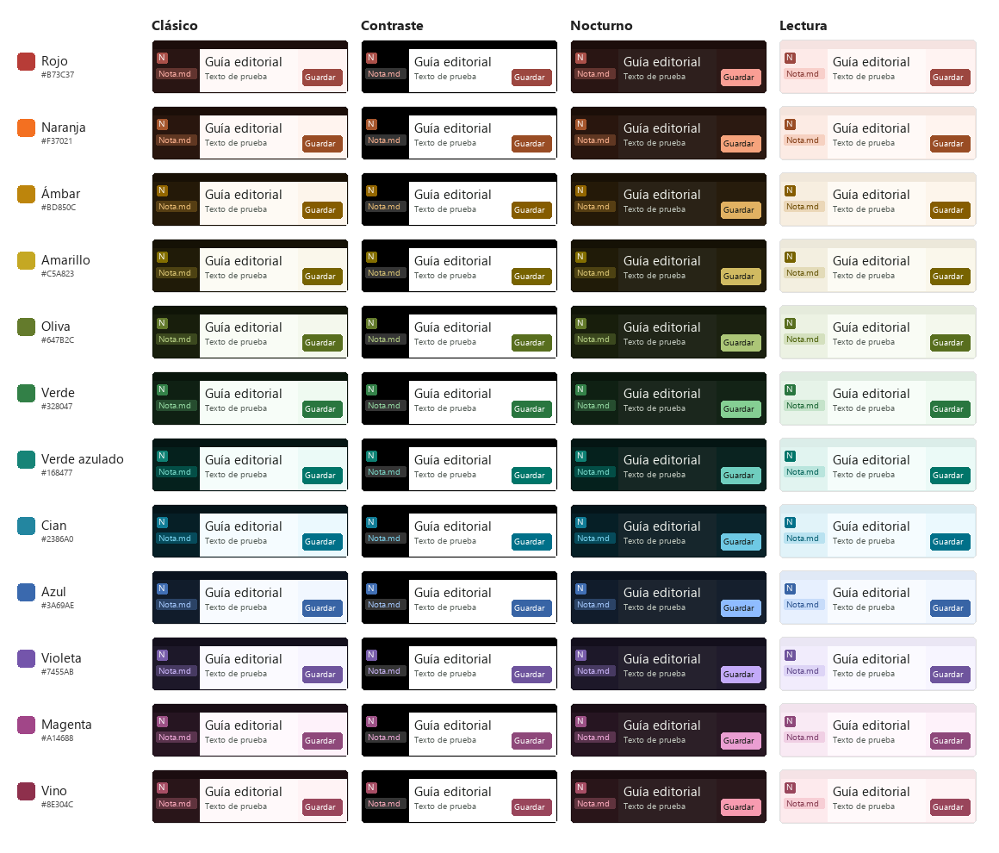

# Paletas de apariencia

Contrato técnico de [Apariencia](../product/apariencia.md). La definición fija los valores sRGB para el selector y las superficies del producto. Se elaboraron a partir del matiz de cada muestra, con luminosidad y cromaticidad ajustadas al uso. Los valores de estas tablas son la referencia para la implementación.

## Resolución de colores

- El perfil asigna un contexto claro u oscuro a cada superficie. El marco y el lateral comparten el mismo fondo, también en las miniaturas. Clásico y Contraste asignan oscuro al marco y lateral, y claro al editor y herramientas. Nocturno asigna oscuro a todas las superficies y Lectura asigna claro.
- Configuración es una superficie del editor con su propio lateral. Los menús, diálogos y desplegables heredan el contexto de la superficie donde se abren, incluso cuando se renderizan en un portal. Los elementos nativos de Android usan modo oscuro en Nocturno. Los elementos ligados visualmente al marco, como la barra de estado, resuelven su texto e iconos contra el fondo de ese marco.
- La superficie elevada sirve para menús, diálogos y campos que necesiten un fondo propio. El separador es decorativo. El borde de control identifica campos y otros controles cuando el relleno por sí solo no es suficiente.
- Hover suave corresponde a filas y acciones secundarias. Selección corresponde a una fila, una pestaña o un perfil activo, con su indicador en Acento y foco. El menú lateral de Configuración indica el apartado activo con el fondo de selección y el icono en color de acento. Al pasar el puntero sobre una selección se conserva su indicador. El botón principal usa los tres rellenos de acción con el mismo color de texto para su contexto.
- Acento y foco se usa en enlaces, iconos destacados e indicadores de selección. El anillo de teclado tiene al menos 2 px y se separa del control con un espacio del color de la superficie que lo rodea. El anillo y la selección se pueden mostrar a la vez. En el editor, una selección de texto usa el fondo de selección con el texto legible de su contexto.
- El recuadro de la marca usa el tono Logotipo de su superficie. El símbolo usa blanco `#FFFFFF`. La marca de selección de cada muestra usa el valor indicado en el catálogo, con un anillo exterior visible sobre la superficie que contiene las muestras.
- El `color-scheme` y las barras de desplazamiento se resuelven por superficie. El contenido con colores propios, como imágenes, resaltados Markdown y PDF, se presenta con los colores de su contenido.

## Catálogo y tonos sRGB

| Paleta | Muestra | Marca en la muestra |
| --- | --- | --- |
| Rojo | `#B73C37` | `#FFFFFF` |
| Naranja | `#F37021` | `#000000` |
| Ámbar | `#BD850C` | `#000000` |
| Amarillo | `#C5A823` | `#000000` |
| Oliva | `#647B2C` | `#FFFFFF` |
| Verde | `#328047` | `#FFFFFF` |
| Verde azulado | `#168477` | `#000000` |
| Cian | `#2386A0` | `#000000` |
| Azul | `#3A69AE` | `#FFFFFF` |
| Violeta | `#7455AB` | `#FFFFFF` |
| Magenta | `#A14688` | `#FFFFFF` |
| Vino | `#8E304C` | `#FFFFFF` |

### Fondos claros

| Paleta | Marco y lateral | Editor | Herramientas | Elevado |
| --- | --- | --- | --- | --- |
| Rojo | `#F5E3E1` | `#FFF9F8` | `#FFF3F2` | `#FFFDFD` |
| Naranja | `#F4E4DD` | `#FFF9F7` | `#FFF4EF` | `#FFFDFD` |
| Ámbar | `#F0E7DA` | `#FEFAF4` | `#FDF5EB` | `#FFFDFB` |
| Amarillo | `#ECE8DA` | `#FCFBF4` | `#FAF7EB` | `#FFFEFA` |
| Oliva | `#E5EBDC` | `#F9FCF5` | `#F4F8ED` | `#FDFEFB` |
| Verde | `#DFECE1` | `#F7FDF8` | `#EFFAF1` | `#FCFFFC` |
| Verde azulado | `#DBEDE9` | `#F5FDFB` | `#EBFAF7` | `#FAFFFE` |
| Cian | `#DAECF2` | `#F5FCFF` | `#EBF9FE` | `#FCFEFF` |
| Azul | `#E0E9F6` | `#F8FBFF` | `#F1F7FF` | `#FDFEFF` |
| Violeta | `#EAE6F4` | `#FBFAFF` | `#F7F5FF` | `#FEFDFF` |
| Magenta | `#F2E3ED` | `#FFF9FD` | `#FEF2FA` | `#FFFDFE` |
| Vino | `#F5E3E6` | `#FFF9FA` | `#FFF3F5` | `#FFFDFD` |

### Fondos oscuros

| Paleta | Marco y lateral | Editor | Herramientas | Elevado |
| --- | --- | --- | --- | --- |
| Rojo | `#1C0D0B` | `#2E1F1D` | `#2C1816` | `#3C2826` |
| Naranja | `#1B0E08` | `#2E201A` | `#2B1911` | `#3B2921` |
| Ámbar | `#181005` | `#2A2216` | `#271C0C` | `#362C1D` |
| Amarillo | `#151105` | `#272416` | `#231E0C` | `#332E1D` |
| Oliva | `#0F1407` | `#212619` | `#1B2110` | `#2B3120` |
| Verde | `#09150B` | `#1B271D` | `#132316` | `#233226` |
| Verde azulado | `#041513` | `#162724` | `#0A2320` | `#1C332F` |
| Cian | `#041419` | `#16262C` | `#0A2229` | `#1C3239` |
| Azul | `#0A121D` | `#1C242F` | `#151F2D` | `#252F3D` |
| Violeta | `#130F1C` | `#25212E` | `#201B2C` | `#302B3B` |
| Magenta | `#190D15` | `#2C1F27` | `#281823` | `#382833` |
| Vino | `#1B0D10` | `#2E1F22` | `#2B181C` | `#3B282C` |

### Bordes y estados sobre superficies claras

| Paleta | Separador | Borde de control | Hover suave | Selección |
| --- | --- | --- | --- | --- |
| Rojo | `#ECDCDA` | `#7F6865` | `#F7DFDB` | `#F8CFCA` |
| Naranja | `#EBDDD6` | `#7E6A60` | `#F5E0D6` | `#F6D1C1` |
| Ámbar | `#E7DFD3` | `#786D5B` | `#EFE3D1` | `#EBD7B8` |
| Amarillo | `#E3E0D3` | `#746F5B` | `#EAE5D1` | `#E3DBB8` |
| Oliva | `#DDE2D5` | `#6B725F` | `#E1E8D5` | `#D4E0BE` |
| Verde | `#D8E4DA` | `#637465` | `#D9EADB` | `#C5E3CA` |
| Verde azulado | `#D4E4E1` | `#5C7570` | `#D2EBE6` | `#B9E5DD` |
| Cian | `#D4E3E8` | `#5C737B` | `#D2EAF1` | `#B9E2F0` |
| Azul | `#D9E1EC` | `#647080` | `#DAE6F7` | `#C7DCFA` |
| Violeta | `#E1DEEB` | `#716B7E` | `#E7E1F5` | `#DDD4F6` |
| Magenta | `#E9DCE4` | `#7B6874` | `#F2DEEB` | `#F0CFE4` |
| Vino | `#EBDBDE` | `#7F686C` | `#F6DEE2` | `#F7CED5` |

### Bordes y estados sobre superficies oscuras

| Paleta | Separador | Borde de control | Hover suave | Selección |
| --- | --- | --- | --- | --- |
| Rojo | `#443230` | `#A58B88` | `#4C302D` | `#62342F` |
| Naranja | `#44332C` | `#A38D83` | `#4A3226` | `#603722` |
| Ámbar | `#3F3628` | `#9D907D` | `#44361F` | `#563E13` |
| Amarillo | `#3C3828` | `#98927D` | `#3F381F` | `#4D4212` |
| Oliva | `#343A2B` | `#8E9681` | `#343C24` | `#3B481E` |
| Verde | `#2E3C30` | `#859888` | `#293F2D` | `#264D2F` |
| Verde azulado | `#283C39` | `#7E9994` | `#1E3F3A` | `#034E46` |
| Cian | `#283B41` | `#7E979F` | `#1E3D47` | `#064B5B` |
| Azul | `#2F3846` | `#8793A6` | `#2B394E` | `#2B4366` |
| Violeta | `#393544` | `#948EA3` | `#3B344B` | `#473A62` |
| Magenta | `#41323C` | `#A08B98` | `#47303F` | `#5A344E` |
| Vino | `#443235` | `#A48B8F` | `#4B2F35` | `#60333D` |

### Acciones y marca sobre superficies claras

| Paleta | Acción normal | Acción hover | Acción pulsada | Acento y foco | Logotipo |
| --- | --- | --- | --- | --- | --- |
| Rojo | `#9C4740` | `#913D37` | `#83342F` | `#83342F` | `#9C4740` |
| Naranja | `#994C24` | `#8E4219` | `#803A11` | `#803A11` | `#994C24` |
| Ámbar | `#855C00` | `#795300` | `#6C4A00` | `#6C4A00` | `#855C00` |
| Amarillo | `#776300` | `#6C5A00` | `#605000` | `#605000` | `#776300` |
| Oliva | `#586E1E` | `#4F6510` | `#455A00` | `#455A00` | `#586E1E` |
| Verde | `#29763F` | `#1D6C35` | `#14612E` | `#14612E` | `#29763F` |
| Verde azulado | `#007569` | `#006A5F` | `#005F55` | `#005F55` | `#007569` |
| Cian | `#007089` | `#00667C` | `#005B6F` | `#005B6F` | `#007089` |
| Azul | `#3864A5` | `#2F5A9A` | `#27508D` | `#27508D` | `#3864A5` |
| Violeta | `#6E549D` | `#644A92` | `#594185` | `#594185` | `#6E549D` |
| Magenta | `#8E487A` | `#843E70` | `#773665` | `#773665` | `#8E487A` |
| Vino | `#99455B` | `#8E3B52` | `#813348` | `#813348` | `#99455B` |

### Acciones y marca sobre superficies oscuras

| Paleta | Acción normal | Acción hover | Acción pulsada | Acento y foco | Logotipo |
| --- | --- | --- | --- | --- | --- |
| Rojo | `#FA9E94` | `#FFB0A7` | `#EE9187` | `#FFB0A7` | `#AA5049` |
| Naranja | `#F6A37C` | `#FFB38F` | `#EA966E` | `#FFB38F` | `#A6562D` |
| Ámbar | `#E1B162` | `#EDBF76` | `#D6A553` | `#EDBF76` | `#936600` |
| Amarillo | `#D0BA61` | `#DCC775` | `#C4AD51` | `#DCC775` | `#836E00` |
| Oliva | `#ACC677` | `#B9D386` | `#A0BA6B` | `#B9D386` | `#637A2B` |
| Verde | `#85CF93` | `#95DBA3` | `#76C286` | `#95DBA3` | `#348249` |
| Verde azulado | `#6FCEBF` | `#7CDCCC` | `#62C2B3` | `#7CDCCC` | `#0F8174` |
| Cian | `#6EC9E4` | `#7CD6F2` | `#61BCD7` | `#7CD6F2` | `#117C96` |
| Azul | `#8FBCFF` | `#A5C9FF` | `#80B0F6` | `#A5C9FF` | `#416FB4` |
| Violeta | `#C3AAF9` | `#CFBAFF` | `#B79EED` | `#CFBAFF` | `#795EAB` |
| Magenta | `#EA9ED2` | `#F5ADDE` | `#DE91C6` | `#F5ADDE` | `#9C5186` |
| Vino | `#F79BB0` | `#FFACBE` | `#EB8EA3` | `#FFACBE` | `#A74E65` |

### Texto e iconos comunes

Los iconos ordinarios usan el tono secundario y los que son esenciales para identificar una acción pueden usar el principal. Los indicadores de error, aviso, éxito y conexión usan sus propias combinaciones.

| Uso | Claro | Oscuro |
| --- | --- | --- |
| Texto principal | `#1E211F` | `#F1F3EE` |
| Texto secundario | `#525B55` | `#C1C8BE` |
| Deshabilitado | `#7C817C` | `#81877E` |
| Texto e icono de botón principal | `#FFFFFF` | `#161A15` |

### Fondos del perfil Contraste

Los tonos de acciones, foco y logotipo siguen las tablas de la paleta elegida. Para las superficies y estados suaves se usan estos neutros.

| Uso | Claro | Oscuro |
| --- | --- | --- |
| Marco y lateral | `#FFFFFF` | `#000000` |
| Editor | `#FFFFFF` | `#000000` |
| Herramientas | `#FFFFFF` | `#000000` |
| Elevado | `#FFFFFF` | `#171717` |
| Separador | `#DEDEDE` | `#333333` |
| Borde de control | `#676767` | `#959595` |
| Hover suave | `#F0F0F0` | `#222222` |
| Selección | `#E7E7E7` | `#353535` |

### Estados semánticos

| Estado | Fondo claro | Texto e icono sobre claro | Fondo oscuro | Texto e icono sobre oscuro |
| --- | --- | --- | --- | --- |
| Conexión | `#E7F5F0` | `#185444` | `#183A30` | `#BCEBD9` |
| Éxito | `#E8F5EB` | `#174F30` | `#173B27` | `#ADE8BB` |
| Aviso | `#FFF3D4` | `#6E470B` | `#3F300F` | `#FFE29A` |
| Error | `#FCEBEB` | `#8C2529` | `#481F24` | `#FFD2D3` |

## Comprobación de la definición

La definición original superó **4.860 comparaciones** de luminancia relativa sRGB para las **48 combinaciones** de perfil y paleta. Se evaluó cada contexto presente en cada combinación, incluidos los fondos elevados, hover y selección. Los tres estados del botón se contrastaron también contra cada fondo aplicable. El lateral adopta el fondo del marco, ya incluido en esas comparaciones. La lámina superior representa la definición original.

| Par comprobado | Comparaciones | Mínimo observado | Umbral |
| --- | --- | --- | --- |
| texto | 408 | 8,60:1 | 4,5:1 |
| texto secundario | 408 | 4,93:1 | 4,5:1 |
| acento en texto | 408 | 5,47:1 | 4,5:1 |
| foco/anillo con separación | 408 | 5,47:1 | 3:1 |
| borde de control | 408 | 3,13:1 | 3:1 |
| texto de botón | 1224 | 5,58:1 | 4,5:1 |
| relleno de botón | 1224 | 4,04:1 | 3:1 |
| marca N | 72 | 4,73:1 | 4,5:1 |
| texto/icono de estado | 288 | 7,40:1 | 4,5:1 |
| marca del selector | 12 | 4,60:1 | 4,5:1 |

Se usaron [WCAG 2.2 1.4.3 para texto](https://www.w3.org/WAI/WCAG22/Understanding/contrast-minimum.html) y [1.4.11 para controles e indicadores](https://www.w3.org/WAI/WCAG22/Understanding/non-text-contrast.html). El umbral de la marca forma parte de esta definición de Neubiki. Las mediciones corresponden a colores opacos de la especificación. La validación en la aplicación deberá comprobar los valores calculados y su presentación efectiva.

## Plan de implementación y verificación

1. Ampliar el contrato de apariencia nativo y su normalización frontend. Reutilizar la lectura y escritura de configuración de aplicación por `/api/config`. Leer el original antes de migrarlo y persistir la conversión de forma idempotente, conservando idioma, compatibilidad Markdown y preferencias ajenas al apartado. Serializar las escrituras de apariencia y asociar la confirmación a la última elección vigente.
2. Construir una fuente única de tonos tipados y resolver sus variables por superficie. Aplicarlas en el espacio de Proton, la configuración, el editor, las herramientas y sus portales. Mantener el naranja como color inicial y habilitar Azul como una opción de personalización. Dar al logotipo de interfaz su fondo y símbolo por separado para preservar su forma al cambiar el color.
3. Añadir el formulario a la navegación existente de Configuración en Proton y aplicar sus cambios sobre el estado compartido de aplicación. Mostrar el estado de guardado local y la acción de restablecer. Empaquetar las fuentes aprobadas con sus licencias y variantes necesarias para Windows y Android.
4. Aplicar fuente, tamaños y espaciado en Milkdown mediante estilos del contenido. Mantener separado el zoom puntual del editor. Comprobar que la escala de la interfaz y los cambios de lectura no reinician Milkdown ni alteran la sesión de edición.
5. Verificar el cálculo de tonos y su asignación a las 48 combinaciones con pruebas de contrato. Cubrir cambio de perfil, teclado, selección, guardado, error, reintento, restablecimiento y migración. Revisar en Windows y Android los cuatro perfiles, con atención a Naranja, Oliva y Amarillo, ventanas estrechas, toque, desplazamiento, diálogos y edición con borrador abierto.

La petición de aplicar la definición cubre su integración en el formulario de Proton y en el espacio de trabajo. El runtime guarda el perfil y las preferencias de lectura en el mismo grupo local de apariencia. La prueba de contrato del frontend comprueba los tonos de las 48 combinaciones, el orden de las escrituras, el reintento y el restablecimiento. La comprobación en instalaciones nativas corresponde al apartado Apariencia de la lista de pruebas manuales.
